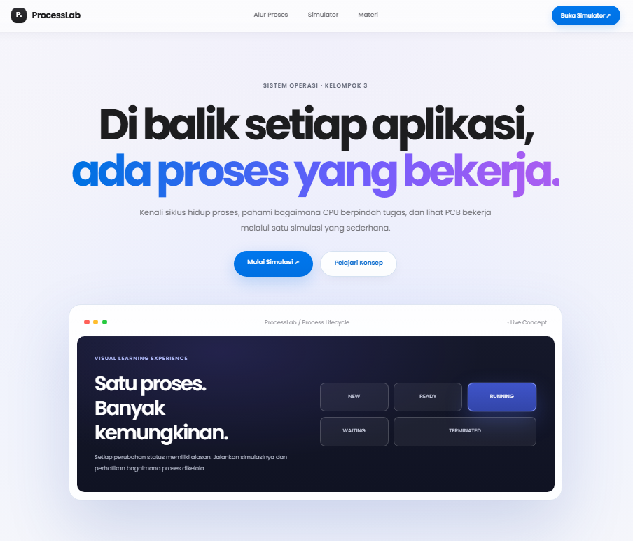
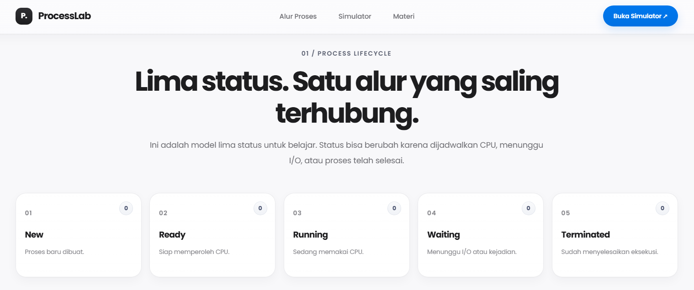
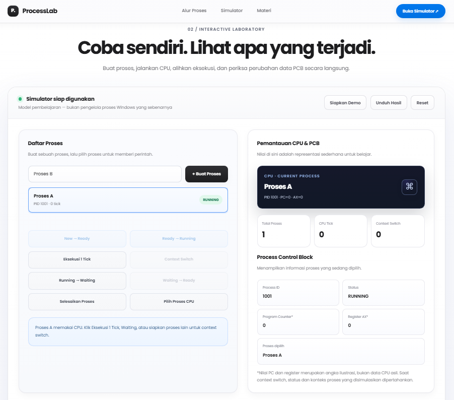
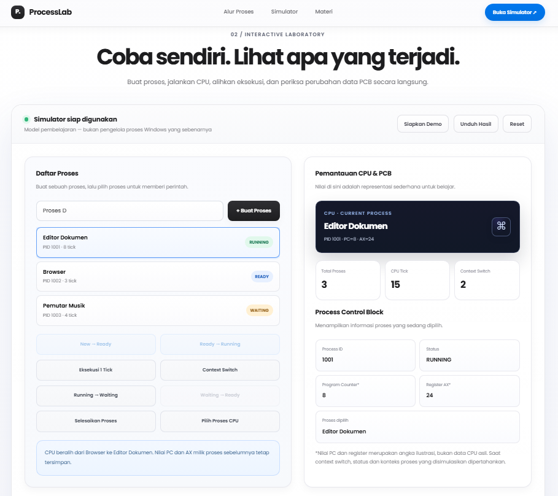
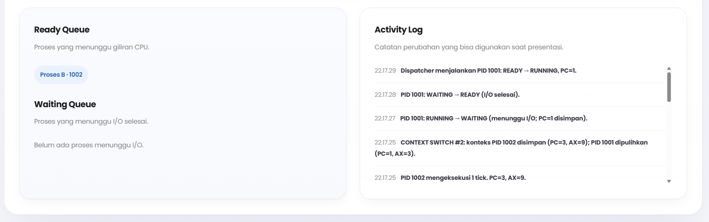

# ProcessLab

## Interactive Operating System Process Management Simulator

Group 3 · 2026

ProcessLab is a web-based educational simulator designed to help users understand operating system process management, including process life cycles, CPU utilization, Process Control Blocks (PCB), process queues, and context switching.

All simulations run directly in the browser as an educational model. ProcessLab does not interact with or manage actual Windows operating system processes.

## 1. Key Features

### Home Page and Navigation

- An introductory page presenting ProcessLab and its purpose.
- Navigation menus for Process Flow, Simulator, and Learning Materials.
- Quick-access buttons for opening the simulator and learning modules.

### Process Life Cycle Visualization

ProcessLab illustrates the five fundamental process states:

1. NEW — A process has been newly created.
2. READY — A process is ready for execution and waiting for CPU allocation.
3. RUNNING — A process is currently using the simulated CPU.
4. WAITING — A process is waiting for I/O operations or another event.
5. TERMINATED — A process has completed execution and cannot be executed again.

The number of processes in each state is updated dynamically whenever the simulation changes.

### Interactive Simulator Laboratory

Users can:

- Create processes with custom names.
- Move processes from NEW to READY.
- Dispatch processes from READY to RUNNING when the CPU is idle.
- Execute one simulated CPU Tick at a time.
- Perform Context Switching between RUNNING and READY processes.
- Move RUNNING processes to WAITING.
- Return WAITING processes to READY.
- Terminate currently running processes.
- Select processes to inspect their information.
- Load predefined demonstration scenarios.
- Download simulation reports.
- Reset the simulation.

### Monitoring and Activity Logging

The dashboard provides real-time information, including:

- Currently running CPU process.
- Total number of processes.
- Total CPU Ticks.
- Total Context Switches.
- Process Control Block (PCB) information:
  - Process ID (PID)
  - Process State
  - Program Counter (PC)
  - AX Register
  - Selected Process Name
- Ready Queue and Waiting Queue.
- Activity Log recording simulation events and process state changes.

### Learning Materials

The learning section contains nine educational modules:

1. Introduction to ProcessLab.
2. The Five Process States.
3. Process Control Block (PCB).
4. CPU Execution and Tick.
5. Context Switching.
6. Understanding the Simulator Dashboard.
7. Hands-on Practice.
8. Reports and Troubleshooting.
9. Limitations and Future Development.

Each module is presented in an expandable card. Interactive examples are also provided to demonstrate how PC and AX values change during CPU Tick execution.

## 2. Technologies Used

| Technology | Purpose |
|---|---|
| HTML5 | Defines the application structure and content. |
| CSS3 | Handles styling, layout, animations, and responsive design. |
| JavaScript | Implements simulation logic and user interactions. |
| Google Fonts (Poppins) | Provides the primary typography. |

The application uses a lightweight architecture without requiring additional frameworks, package installations, databases, backend services, or a dedicated web server.

The HTML, CSS, and JavaScript files are organized separately to improve code readability, maintainability, and project organization.

## 3. Getting Started

### Requirements

- A modern web browser, such as Google Chrome, Microsoft Edge, or Brave.
- The ProcessLab project files.

### Installation and Execution

1. Download or clone this repository.
2. Make sure the project directory structure remains intact.
3. Locate the `index.html` file in the root directory.
4. Open `index.html` using a modern web browser.
5. Click Open Simulator or select the Simulator navigation menu to access the laboratory.
6. Click Load Demo to explore the predefined scenario, or create your own processes using + Create Process.

ProcessLab can run locally by opening the HTML file directly in a browser.

An internet connection is not required for the simulation logic. However, an internet connection is recommended to load the Poppins font from Google Fonts. A fallback font will be used if the online font is unavailable.

## 4. How to Use the Simulator

### A. Creating and Running a Process

1. Enter a process name in the process name field.
2. Click + Create Process. The new process will initially have the NEW state.
3. Select the process and click New → Ready.
4. When the CPU is idle, click Ready → Running.
5. Click Execute 1 Tick to perform one unit of simulated execution.
6. Observe changes in the PC, AX, CPU Tick, PCB, and Activity Log.

### B. Simulating I/O Operations

1. Make sure the selected process is currently RUNNING.
2. Click Running → Waiting.
3. Select the process again if necessary.
4. Click Waiting → Ready to simulate the completion of an I/O operation.
5. If the CPU is idle, the process can be executed again through Ready → Running.

### C. Performing Context Switching

1. Prepare one process in the RUNNING state.
2. Prepare at least one additional process in the READY state.
3. Select the READY process that will receive CPU allocation.
4. Click Context Switch once.
5. Observe how the previous process changes to READY and the target process becomes RUNNING.

Important: Selecting a process only changes the process being monitored. It does not automatically transfer CPU allocation. The actual CPU transfer occurs when the Context Switch button is executed.

### D. Terminating a Process

Select the currently RUNNING process and click Finish Process.

Its state will change to TERMINATED, and it cannot be executed again within the simulation.

### E. Simulator Controls

| Button | Function |
|---|---|
| `+ Create Process` | Creates a new process in the NEW state. |
| `New → Ready` | Moves a process from NEW to READY. |
| `Ready → Running` | Executes a READY process when the CPU is idle. |
| `Execute 1 Tick` | Performs one unit of simulated CPU execution. |
| `Context Switch` | Transfers CPU allocation from the RUNNING process to a READY process. |
| `Running → Waiting` | Moves the RUNNING process to WAITING. |
| `Waiting → Ready` | Returns a WAITING process to READY. |
| `Finish Process` | Changes the RUNNING process to TERMINATED. |
| `Select CPU Process` | Selects the process currently using the CPU for PCB monitoring. |
| `Load Demo` | Loads the predefined three-process demonstration scenario. |
| `Download Results` | Downloads the simulation report in TXT format. |
| `Reset` | Clears processes, counters, and simulation history. |

## 5. Simulation Rules

### CPU Tick, PC, and AX

Whenever Execute 1 Tick is clicked while a process is RUNNING:

- PC increases by 1.
- AX increases by 3 using modulo 256.
- The process execution tick count increases by 1.
- The total CPU Tick count increases by 1.

The AX calculation follows this formula:

```javascript
AX_new = (AX_old + 3) % 256;
```

PC and AX values are illustrative values managed by JavaScript. They do not represent actual physical CPU register readings.

### Context Switching

Context Switching can only be performed when the following conditions are met:

- One process is currently RUNNING.
- At least one other process is in the READY state.

If the selected process is READY, it becomes the target of the context switch. Otherwise, the simulator selects the first available READY process.

During a successful Context Switch:

- The previous RUNNING process changes to READY.
- The target process changes to RUNNING.
- The Context Switch counter increases by one.

Context Switching does not increase the CPU Tick count because it represents process allocation transfer rather than execution of a CPU Tick.

### Simulation Data Limits

- Maximum number of processes: 30.
- Maximum process name length: 40 characters.
- Activity Log capacity: 80 most recent events per session.
- Initial PID: 1001.
- PID numbering restarts from 1001 after Reset.
- Simulation data is temporarily stored in browser memory, not in a database or permanent storage.

## 6. Built-in Demonstration Scenario

Clicking Load Demo loads the following three processes:

| PID | Process Name | State | PC | AX | Process Ticks |
|---|---|---|---:|---:|---:|
| 1001 | Document Editor | RUNNING | 8 | 24 | 8 |
| 1002 | Browser | READY | 3 | 9 | 3 |
| 1003 | Music Player | WAITING | 4 | 12 | 4 |

Initial demonstration conditions:

- Total Processes: 3
- CPU Tick: 15
- Context Switch: 0
- Currently Running Process: Document Editor
- Selected Process: Browser

After selecting Browser and clicking Context Switch once:

- Document Editor changes from RUNNING to READY.
- Browser changes from READY to RUNNING.
- Music Player remains in WAITING.
- The CPU is now allocated to Browser (PID 1002).
- Context Switch count becomes 1.
- CPU Tick remains 15 until Execute 1 Tick is clicked.

## 7. Downloading Simulation Reports

Click Download Results to generate the following file:

`hasil_simulasi_kelompok_3.txt`

The report includes:

- Report generation date and time.
- Total number of processes.
- CPU Tick count.
- Context Switch count.
- PCB information for every process, including PID, name, state, PC, AX, and process ticks.
- Simulation activity history.

The report reflects the simulator's current state at the time of download. Therefore, report contents may differ between simulation sessions.

If no process has been created, the simulator displays a notification indicating that there are no simulation results to export and does not generate a report file.

## 8. Program Limitations

ProcessLab is an educational simulator with the following limitations:

- It does not read, execute, or control actual Windows processes.
- It is not intended to replace Windows Task Manager or an operating system.
- It models a single simulated CPU, allowing only one process to be in the RUNNING state at a time.
- It does not yet implement complete automatic scheduling algorithms such as FCFS or Round Robin.
- PID, PC, AX, and CPU Tick values are illustrative simulation data.
- Simulation data is not permanently stored. Refreshing or reloading the page resets the simulation.

FCFS, Round Robin, additional visual explanations, and persistent simulation history are potential future improvements, not currently implemented features.

## 9. Troubleshooting

| Issue | Recommended Solution |
|---|---|
| The file opens as plain text or source code. | Make sure the file has the `.html` extension, such as `index.html`. |
| Action buttons are disabled. | Check the selected process state and CPU availability. Buttons are only enabled when their required conditions are met. |
| Context Switch cannot be performed. | Make sure one process is RUNNING and at least one other process is READY. |
| The CPU remains idle. | Create a process, move it to READY, and then click Ready → Running. |
| Download Results does not generate a file. | Make sure at least one process has been created. Check the browser's download folder and download permissions. |
| Simulation data disappears after refreshing. | Simulation data is stored temporarily in browser memory. Download the TXT report before refreshing if you need to keep the results. |
| The font looks different. | Check your internet connection to load Poppins. If unavailable, the browser will use a fallback font. |

## 10. Repository Structure

The project files are organized as follows:

```text
processlab-process-management-simulator/
│
├── assets/
│   ├── README.md
│   └── screenshots/
│       ├── 01-beranda.png
│       ├── 02-laboratorium.png
│       ├── 03-running-process.png
│       ├── 04-process-queues.png
│       └── 05-activity-log.png
│
├── css/
│   └── style.css
│
├── js/
│   └── app.js
│
├── README.md
└── index.html
```

### File and Directory Description

- `index.html` — Main application structure and entry point.
- `css/style.css` — Application styling, layout, animations, and responsive design.
- `js/app.js` — Simulator logic, process management, CPU execution, event handling, and interface interactions.
- `assets/` — Supporting project assets and visual documentation.
- `assets/screenshots/` — Application screenshots used for project documentation.
- `README.md` — Main project documentation.

The separation of HTML, CSS, and JavaScript helps maintain a cleaner and more manageable codebase.

## 11. Visual Documentation

This section presents the visual documentation of ProcessLab, covering the home page, interactive simulator, process execution, process queues, and activity logging.

### 11.1 Home Page

The main landing page introduces ProcessLab and provides an overview of the simulator and its learning objectives.



### 11.2 Interactive Laboratory and Process Lifecycle

This section presents the interactive simulation environment and the process management interface.



### 11.3 Running Process

Displays the process currently using the CPU, together with its Process Control Block (PCB), including Process ID, Program Counter, and AX Register.



### 11.4 Process Queues

Visualizes the Ready Queue and Waiting Queue, showing processes waiting for CPU allocation or I/O completion.



### 11.5 Activity Log

Displays the simulation activity history, including process state transitions, CPU execution, and context switching events.



---

ProcessLab · Operating System Process Management Simulator · Group 3 · 2026

An educational project developed to explore process management, process states, Process Control Blocks, CPU execution, process queues, and context switching.
